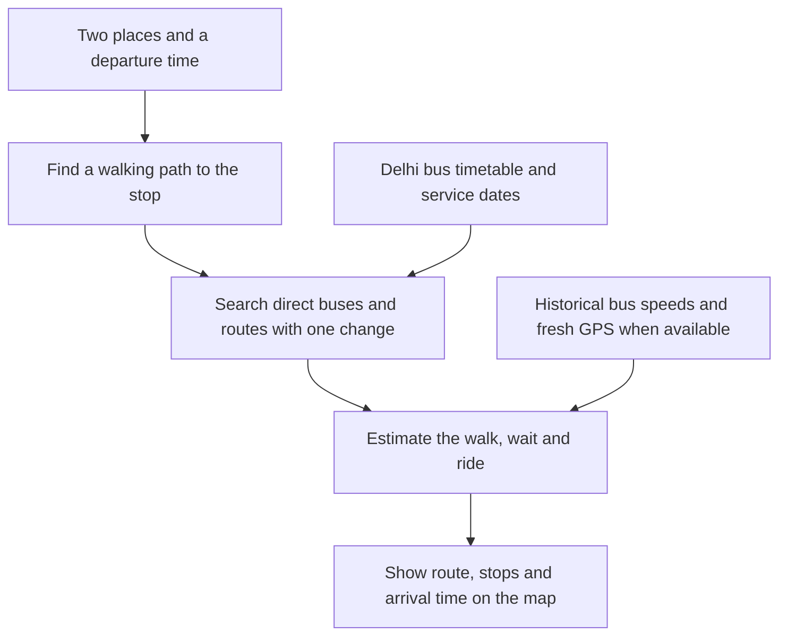

# Delhi Bus Atlas

A passenger enters a starting point, a destination and a departure time. Atlas shows which Delhi bus to board, where to change and when the passenger could arrive. Each option separates walking, waiting and riding.

**Team IITBOYS** · Shubham Jain, Akhil Goyal and Keshav Gilra  
Transport Stack Hackathon 2026 · Phase 1, Problem 1

## How a journey is planned



A scheduled departure, an estimate learned from GPS and a fresh observation each carry a different label. On a divided road, the planner checks whether there is a mapped path to the boarding side. It can show a bus that might still be boarding alongside a later fallback.

## Run the Delhi planner

1. Install Python **3.12**. Download or clone this repository.
2. Get **Delhi Buses: GTFS Static Data – DTC / DoT** from the [official Transport Stack catalogue](https://delhi.transportstack.in/data-services). Save the original ZIP as `delhi_buses_static_gtfs_v1.zip` beside `run.py`. Judges can also copy that one file from the submitted working-prototype ZIP. The October GPS and ticket archives are unnecessary for running the app.
3. From this folder, run the commands below. The first run builds a timetable index and can take a few minutes.

**Windows PowerShell**

```powershell
py -3.12 -m venv .venv
.\.venv\Scripts\python.exe -m pip install -r requirements.txt
.\.venv\Scripts\python.exe run.py --offline
```

**macOS / Linux**

```sh
python3.12 -m venv .venv
.venv/bin/python -m pip install -r requirements.txt
.venv/bin/python run.py --offline
```

Open the [passenger map](http://127.0.0.1:8765/), [runnable API guide](http://127.0.0.1:8765/api-guide) or [journey comparisons](http://127.0.0.1:8765/field-trials.html). The public copy includes the walking map, learned weekday and weekend estimates, and aggregate checks. The judge package also carries dated vehicle feeds for replay.

**Try a real query.** [Compare 08:45 and 13:00 on 15 October](http://127.0.0.1:8765/journeys?from=1025&to=2560&depart=2026-10-15T08:45&compare_hour=13). For map pins, enter latitude and longitude. Any full itinerary lists the boarding and exit stops and the seconds spent walking, waiting and riding. API times use Delhi local time.

## What the evidence tells us

GPS can test when a bus passed a stop. It cannot tell us whether a passenger crossed the road in time or whether a crowded bus let them board. At Punjabi Bagh, Atlas predicted about a minute of waiting. GPS first showed a qualifying route 159 roughly 20 minutes after the requested start. An earlier bus could have been missing from the feed. The [comparison screen](http://127.0.0.1:8765/field-trials.html) shows where each estimate could be checked.

Further work should test waits on routes with irregular service, verify road crossings near AIIMS, and repeat after-midnight boarding checks on fresh dates. [Build guide, data and test commands](AGENTS.md) · [Technical note](docs/technical-note.md) · [Credits](CREDITS.md) · [Official challenge](https://delhi.transportstack.in/hackathon/)
