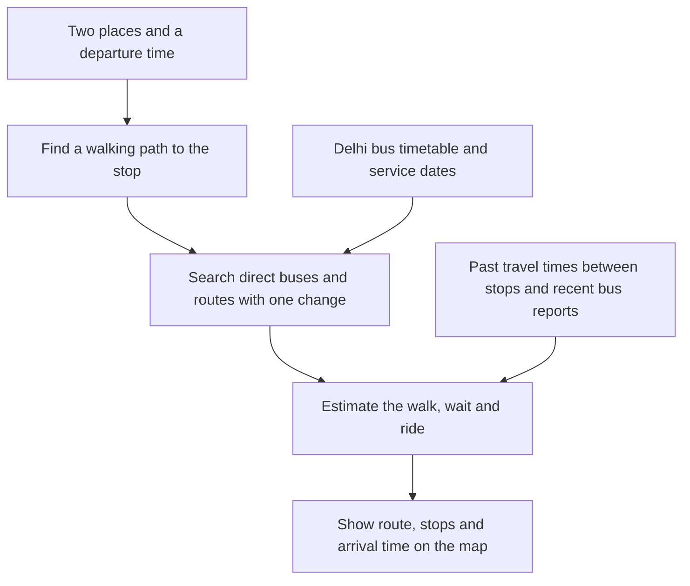

# Delhi Bus Atlas

Enter two places in Delhi and the time you want to leave. Atlas shows where to walk, which bus to take, where to change and when you could reach your destination. In the recorded Rohini Sector 22 to Azadpur example, taking one bus saves about 12 minutes of walking and gets you there an estimated four minutes later than changing buses.

[Open the journey planner](https://iitboys-delhi-bus-atlas.vercel.app) · [Try the API](https://iitboys-delhi-bus-atlas.vercel.app/api-guide)

Travelling now? Choose **Use my location** beside **From**, allow location access, then choose **Now** and **Find journeys**. You can also type a stop or pick a point on the map.

[Proposal (PDF)](submission/01-proposal.pdf) · [Technical note (PDF)](submission/02-technical-note.pdf) · [Validation report (PDF)](submission/05-validation.pdf) · [How the October GPS was used](docs/october-gps-coverage.md)

**Team IITBOYS** · Shubham Jain, Akhil Goyal and Keshav Gilra  
Transport Stack Hackathon 2026 · Phase 1, Problem 1

## How a journey is planned



Atlas checks both ends of the trip. A farther stop can get you there sooner if the bus leaves earlier or takes a more direct route. For direct buses Atlas considers stops within 1.1 km at each end. For a journey with one change it keeps up to 12 reachable platforms at each end and checks up to 180 transfer candidates. A bus can also get you close when the final street connection is uncertain. The planner shows the time to the drop-off and labels any estimate for the remaining walk.

Atlas lists journeys by expected arrival at the destination. On a divided road, it looks for a walking path to the side where the bus stops. If a direct bus is due before the walk is over, Atlas can show its time separately so you can decide whether you can reach it sooner.

Open a bus leg to see other lines serving the same two stops. **Check next bus at this stop** shows the next arrival estimate and its source. When GPS has tracked two buses approaching the same stop, it also shows how far apart they came. [First-bus test](docs/first-direct-bus.md) · [API fields](docs/api.md)

## Run the Delhi planner

1. Install Python **3.12**. Download or clone this repository.
2. Get **Delhi Buses: GTFS Static Data – DTC / DoT** from the [official Transport Stack catalogue](https://delhi.transportstack.in/data-services). Save the original ZIP as `delhi_buses_static_gtfs_v1.zip` beside `run.py`. This is the only separate data download needed to run the public source.
3. From this folder, run the commands below. The first run builds a timetable index and can take a few minutes.

Keep the included `data/walk.npz` walking network and `data/walk-crossings.json` crossing connections together in `data/`. The repository also includes the map and fitted travel-time files.

The event brief describes about 10,500 stops. Atlas uses version 32 of the supplied timetable. Its stop file contains 6,862 distinct stop IDs, and all 6,862 appear in scheduled trips. The organizer’s data sheet and the supplied timetable give different totals. [Timetable details](docs/technical-note.md)

**Windows PowerShell**

```powershell
py -3.12 -m venv .venv
.\.venv\Scripts\python.exe -m pip install -r requirements.txt
.\.venv\Scripts\python.exe run.py --offline
```

**macOS / Linux**

```sh
python3.12 -m venv .venv
.venv/bin/python -m pip install -r requirements.txt
.venv/bin/python run.py --offline
```

Open the [local passenger map](http://127.0.0.1:8765/), [local API guide](http://127.0.0.1:8765/api-guide) or [journey comparisons](http://127.0.0.1:8765/field-trials.html). This repository includes the walking map, travel-time estimates for weekdays and weekends, and the results of the GPS checks.

**Try a real query.** [Compare 08:45 and 13:00 on 15 October](http://127.0.0.1:8765/journeys?from=1025&to=2560&depart=2026-10-15T08:45&compare_hour=13). For map pins, enter latitude and longitude. Any full itinerary lists the boarding and exit stops and the seconds spent walking, waiting and riding. API times use Delhi local time.

## What the evidence tells us

Near AIIMS, the original map sent a passenger on an 11 km detour to the eastbound stop. The revised map uses a mapped pedestrian underpass with stairs and short estimated links to the street. It gives a 369 m walk to the official AIIMS Ring Road platform. For a Sunday 3 p.m. request this changed the first suggestion from two buses in about 24 minutes to a direct bus in about 19 minutes. Both times are estimates. The crossing and the passenger’s actual arrival still need a check on foot. [Results on other Delhi routes](docs/journey-access-check.md)

The 19-minute estimate comes from replaying the search with the corrected map. In the 3 p.m. replay, past travel times put the 711UP first. GPS saw it near AIIMS at 3:05, but the operator and timetable disagreed about its stops. We could not verify that it reached the Lajpat Nagar stop. The operator supplied a separate prediction for the 392UP. It was the first direct line GPS saw at both stops, at about 3:12 and 3:22. [Sunday GPS check](data/aiims-observed-order.json)

We also tested 1,728 departures across six October dates. GPS identified a clear first line at the boarding stop in 655 cases. The previous planner picked it 107 times. With individual bus positions, that rose to 114. Ten picks improved and three regressed. In the hourly checks from 12:10 a.m. through 4:10 a.m., correct picks rose from 17 to 18 out of 63. [Delhi results and limitations](docs/first-direct-bus.md)

For 304 searches, GPS also showed when both planners' suggested lines passed. For someone already at the stop, the median extra wait compared with the first verified line fell from 3 minutes 32 seconds to about 3 minutes 5 seconds. [Wait comparison](data/passenger-wait-cost.json)

GPS can test when a bus passed a stop. It cannot tell us whether a passenger crossed the road in time or whether a crowded bus let them board. At Punjabi Bagh, Atlas predicted about a minute of waiting. GPS first showed a qualifying route 159 roughly 20 minutes after the requested start. An earlier bus could have been missing from the feed. The [public journey comparisons](https://iitboys-delhi-bus-atlas.vercel.app/field-trials.html) shows where each estimate could be checked.

Further work should test waits on routes with irregular service, verify road crossings near AIIMS, and repeat after-midnight boarding checks on fresh dates. [Build guide, data and test commands](AGENTS.md) · [Technical note](docs/technical-note.md) · [Credits](CREDITS.md) · [Official challenge](https://delhi.transportstack.in/hackathon/)

## Licence

Team IITBOYS licenses its original source code and documentation under the [MIT License](LICENSE). Materials in `data/`, Delhi transit records, OpenStreetMap-derived maps, Google Maps comparison material and third-party software retain their respective terms. [Data sources and credits](CREDITS.md)
