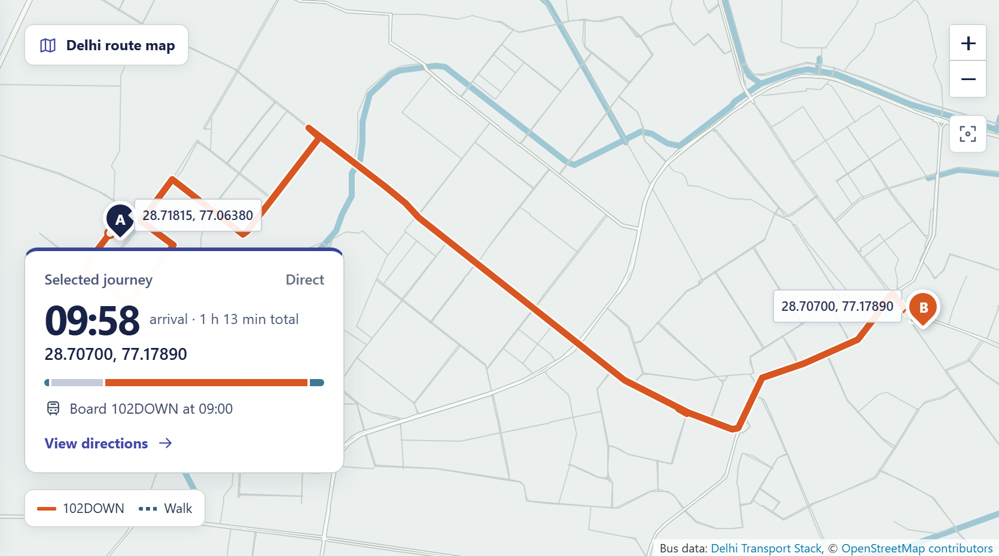
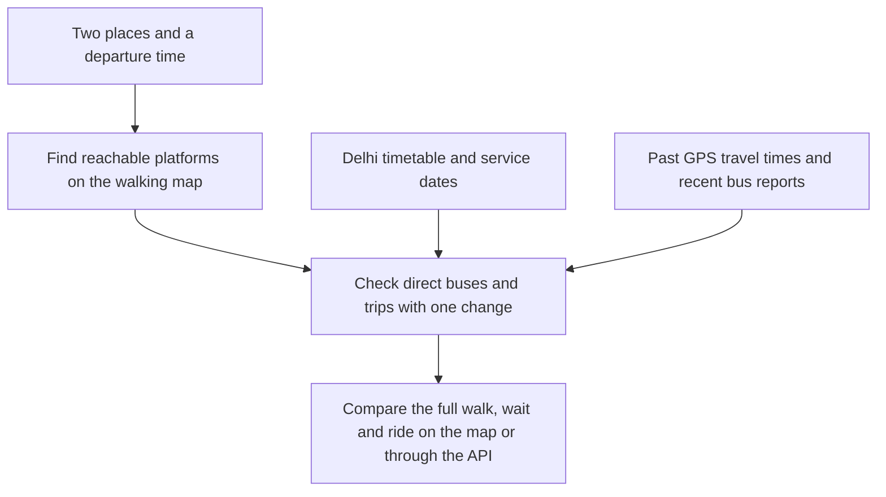

# Delhi Bus Atlas

Delhi Bus Atlas plans trips on Delhi’s existing bus routes, including the time you spend walking and waiting. Give it two places and a departure time. Atlas uses the city’s timetable, bus GPS and a street map to show which bus you can reach, whether a change is worth making and when you could arrive.

**[Open the public planner](https://iitboys-delhi-bus-atlas.vercel.app/) · [Watch the 69-second demo](submission/03-demo-recut.mp4) · [Try the API](https://iitboys-delhi-bus-atlas.vercel.app/api-guide)**

Built by **Team IITBOYS** for Problem 1 of the Delhi Transport Stack Hackathon 2026. [Proposal](submission/01-proposal.pdf) · [Illustrated technical note](submission/02-technical-note.pdf) · [Validation report](submission/05-validation.pdf)

## What a passenger sees

For an 8:45 a.m. departure from Rohini Sector 22 to Azadpur on 15 October, Atlas offered these two choices among its results. Both used the timetable for the ride estimates.

| Journey | Total walking | Estimated arrival |
| --- | ---: | ---: |
| Stay on the 102DOWN | 5 min | 9:58 a.m. |
| Take the 972UP and change to the 761UP at Mangol Pur | 17 min | Just before 9:55 a.m. |

**Recommended** puts the direct bus first. It saves 12 minutes on foot and arrives about three minutes later. A substantially longer walk can rank first if it saves at least 10% of the whole trip. Choose **Earliest arrival** if getting there soonest matters more. The map shows three routes when available and up to two more under **More options**. [How routes are ranked](docs/vivek-vihar-route-check.md)

[](submission/03-demo-recut.mp4)

## How Atlas plans a journey



- **Getting to the bus.** An A* search follows OpenStreetMap streets, crossings and stairs to the correct side of the road. Atlas compares platforms within a 1.1 km mapped walk of each end. At a change, it adds the walk between platforms and a 90-second allowance before checking the onward departure. [Walking method](docs/walking.md)
- **Estimating the ride.** Bus GPS gives typical travel times between consecutive stops in each direction, by two-hour window and weekday or weekend. Recent observations can adjust the estimate. Sparse observations draw on the route’s history or the timetable. November journeys use all 31 days of October history. October replays use only history available at the time. [Model and test dates](docs/october-eta-candidate.md)
- **Showing uncertainty.** A bus stays available when GPS has yet to confirm its scheduled start. Atlas marks a start as confirmed once it has tracked that run from its first passenger stop to its second. A historical search can recreate an estimate. Checking what happened requires GPS recorded at the time. [Departure example](docs/november-departure-audit.md)

## What we tested

| Question | Result |
| --- | --- |
| How close was the estimate for the next stop? | Across 5.94 million GPS-timed movements on 25–31 October, the timetable missed by 55 seconds on average. Atlas missed by 34 seconds. We trained it on 1–24 October and kept the seven test dates out of training. [October test](docs/october-eta-candidate.md) |
| Did we pick the first direct bus? | GPS identified the first line in 655 October cases. Atlas picked it in 114 cases (17.4%) using individual vehicle positions, up from 107. First-bus waits remain harder to predict. [First-bus test](docs/first-direct-bus.md) |
| How did Atlas compare with Google Maps? | We saved forecasts before departure and checked later bus sightings. GPS verified parts of the journeys. A rider would have to time the walks, boarding and final arrival to establish which forecast was closer door to door. [Journey comparisons](https://iitboys-delhi-bus-atlas.vercel.app/field-trials.html) |

## Run the Delhi planner

Download or clone this repository and install **Python 3.12**. The only separate data download needed to run the planner is the official **Delhi Buses: GTFS Static Data** timetable (v32, 6,862 stop IDs). Keep it zipped and save it as `delhi_buses_static_gtfs_v1.zip` next to `run.py`. Keep the supplied `data/` folder in place. It contains the prepared walking map and travel-time models. [Official timetable download page](https://delhi.transportstack.in/data-services/datadetails/1)

From the repository root, run the commands for your system.

**Windows PowerShell**

```powershell
py -3.12 -m venv .venv
.\.venv\Scripts\python.exe -m pip install -r requirements.txt
.\.venv\Scripts\python.exe run.py --offline
```

**macOS or Linux**

```sh
python3.12 -m venv .venv
.venv/bin/python -m pip install -r requirements.txt
.venv/bin/python run.py --offline
```

The first launch builds a local timetable index. Once the server is ready, open the [local map](http://127.0.0.1:8765/) or [local API guide](http://127.0.0.1:8765/api-guide). Offline mode uses the supplied models and needs no API key. Omit `--offline` to enable feed updates. The community feed can supply positions. The optional official feed requires `DELHI_GTFS_RT_KEY`. [Data and setup details](AGENTS.md)

## Use the API

`GET /journeys` accepts `from` and `to` as stop names, stop IDs or latitude/longitude pairs. `depart` is an ISO date and time. A time without an offset uses Delhi time. The API defaults to earliest arrival. Set `preference=balanced` for the order shown under **Recommended**.

```text
GET /journeys?from=28.71815,77.06380&to=28.70700,77.17890&depart=2026-10-15T08:45&preference=balanced&limit=3
```

Each entry in `journeys` gives `arrival`, the legs and their stops, and walking, waiting and riding times in seconds. For the direct bus above, 317 seconds walking + 816 waiting + 3,256 riding = 4,389 seconds door to door. [Open this JSON response](https://iitboys-delhi-bus-atlas.vercel.app/journeys?from=28.71815,77.06380&to=28.70700,77.17890&depart=2026-10-15T08:45&preference=balanced&limit=3)

Use `GET /stops?q=AIIMS` to find a platform, `GET /arrivals?stop=2839&route=1882` for a route-specific prediction and `GET /status` for model and feed information. [API reference](docs/api.md) · [OpenAPI schema](docs/openapi.json)

## Build and maintain

| Part | Implementation |
| --- | --- |
| Timetable and routing | Python reads the official schedule into SQLite. The router checks stop order, service dates, walks and transfers. [Router](transit/router.py) |
| Walking and bus times | NumPy and SciPy support the walking network and spatial lookup. Separate weekday and weekend model files supply historical ride times. [Walking search](transit/walking.py) · [Time estimates](transit/eta.py) · [Live GPS](transit/live.py) |
| Map and API | Leaflet and JavaScript display the journey. FastAPI, Pydantic and Uvicorn serve the local app. Vercel hosts the public planner with its prepared data. [Web client](web/app.js) · [API implementation](transit/api.py) |

To check the router, run `python -m unittest discover -s tests -p test_router.py -v` with the virtual environment’s Python. For the wider suite and model rebuild, see the [contributor guide](AGENTS.md) and [October rebuild instructions](docs/october-eta-candidate.md#reproduce-the-experiment).

## What to improve

The next field test is to ride peak and off-peak journeys and record the walks, waits and changes. Two engineering priorities are estimating waits when scheduled buses run irregularly and verifying walking connections at station entrances. [Bus departure study](docs/november-departure-audit.md) · [Walking audit](docs/gate-audit/README.md)

## Team and licence

Shubham Jain, Akhil Goyal and Keshav Gilra built Delhi Bus Atlas as **Team IITBOYS**. The team’s original code and documentation use the MIT License. Delhi transport data, map data and bundled libraries retain their own terms. The OpenStreetMap-derived walking network and map layer use ODbL 1.0. [MIT licence](LICENSE) · [Data sources, licences and credits](CREDITS.md)
