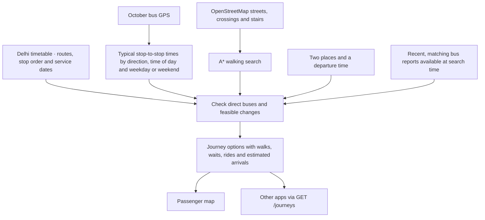

# How Delhi Bus Atlas computes a journey

Atlas compares the whole journey from the first walk to the destination. The timetable tells it which services to consider. The walking map determines which platforms the passenger can reach. Recorded bus movements help estimate the ride between stops. [Illustrated technical note (PDF)](../submission/02-technical-note.pdf)

## Service and geometry

Atlas uses the Delhi timetable supplied for the event, DTC v32. It contains 6,862 distinct stop IDs, 2,574 route records and 80,357 trips. The organiser’s data sheet describes 10,559 stops, 2,403 routes and 89,393 trips. The database indexes the records in the supplied ZIP into 3,498 ordered stop-and-timing patterns. Its SHA-256 is `8eb05d9c21e7a6b42d7b49de45cb095b70ddee5b8f7716859330c9784c322f05`. [Data sources](../CREDITS.md)

The service calendar and stop order determine which buses can serve a journey. After midnight, a bus can still belong to the previous service day. The map uses the published road shape when it aligns with the stops. Otherwise the API labels the line `ordered_stops`, a schematic connecting the stops. [Schedule and routing code](../transit/router.py)

## Travel-time estimation

We measure how long the same bus takes to reach consecutive stops in the right order. Time at traffic lights and stops stays in the measurement. The historical fit excludes duplicate fixes, reports over 90 seconds old at receipt and broken sequences. It stores the median and sample count by route, ordered stop pair and two-hour period. Weekdays and weekends have separate profiles. A sparse time window borrows from the pair’s other hours and the broader route. The timetable supplies the starting estimate when GPS history is missing. [Estimator](../transit/eta.py)

The public planner reads compressed weekday and weekend files from its deployment on Vercel. For November journeys they contain all 31 days of October history. For an October replay the planner chooses the earlier history available by the forecast date. New weeks enter the model when the files are rebuilt. [Training dates and coverage](october-gps-coverage.md)

Recent reports can change a prediction. For example, if three buses have completed the same stretch in the past half-hour and the live feed is fresh, the recent median and the existing estimate receive equal weight. For a particular bus, an upstream sighting or an operator stop prediction must agree with the dated trip and direction. Atlas checks when the report was received and whether vehicle identities conflict. A feed status alone says little about the evidence for an individual ride. [Live adapter](../transit/live.py)

## Passenger routing

1. **Walk to a platform.** Atlas finds a path on OpenStreetMap streets, crossings and stairs. A* uses the straight-line distance remaining to guide the shortest-time search. A divided road may require walking to a crossing. For the same Shivaji Stadium stop, Atlas estimates five minutes to Rajiv Chowk Gate 7 and nine minutes to the pin inside Central Park. The gate walk includes an estimated 26 m between the kerb and the entrance. An offline audit flags similar gaps for review. [Walking assumptions](walking.md) · [Gate audit](gate-audit/README.md)
2. **Check what can be boarded.** Atlas considers platforms within a mapped walk of 1.1 km of each end. A direct bus must serve the boarding and exit platforms in the right order. For one change, Atlas carries the first bus’s arrival forward, adds the transfer walk and a 90-second allowance, then checks the onward bus. If either end has more than 12 reachable platforms, it checks the nearest 12 at each end first, then all reachable platforms. Each pass tests up to 180 connections within the four-hour search window. That limit can miss a connection. [Search and fallback rules](api.md)
3. **Compare the whole trip.** For similar walks, a minute saved on foot can outweigh a smaller gain in arrival time. A substantially longer walk can rank first when it cuts the journey by at least 10%. The map shows three choices when available, with up to two more under *More options*. A passenger can switch to *Earliest arrival*. The API defaults to arrival order. [Ranking rules and Delhi examples](vivek-vihar-route-check.md)

When the map cannot establish a walk, Atlas can list departures from up to two nearby platforms separately. Their clock starts at the platform. Opening a direct bus leg also shows other lines serving the same pair of platforms within the applicable window. [Platform access checks](journey-access-check.md)

## What the judge can try

Open the evening Rohini trip at 5:30 p.m. on 24 November. *Recommended* gives the direct 102ADOWN. Under *Earliest arrival*, the 808STDOWN connection saves 49 seconds and adds about 15 minutes on foot. Open its bus leg to compare the scheduled pickup with the evidence that the run started. Atlas confirms a start only after it has received GPS reports placing the bus at the first passenger stop and then the second. A missing sighting leaves the scheduled option available. The actual time the bus left the depot yard is unknown. [Try the trip](https://iitboys-delhi-bus-atlas.vercel.app/?example=rohini-evening) · [Departure study](november-departure-audit.md)

The map uses the same `GET /journeys` endpoint as any other client. Supply `from`, `to` and `depart` as Delhi local time or with a time-zone offset. A place can be a stop name, stop ID or pair of coordinates. The JSON reply gives the boarding and exit stops, routes, any change, the walk, wait and ride times, and the evidence behind each estimate. Use `compare_hour` to try a second departure hour. [Interactive API guide](https://iitboys-delhi-bus-atlas.vercel.app/api-guide) · [API reference](api.md)

## Interpretation

On 5,941,620 observed rides between consecutive stops, the timetable missed by 55 seconds on average. Atlas trained on four days of GPS missed by 51 seconds and Atlas trained on 1–24 October missed by 34 seconds. Both models predicted the same seven unseen dates without recent updates. These results measure time spent on a moving service, including stops along the way. A rider’s wait, ability to board and final arrival need observations of the passenger. [October comparison](october-eta-candidate.md) · [November forecasts and observations](../submission/05-validation.pdf)

The design draws on Tokyo’s use of recent running times, New York’s matching of vehicles to routes and London’s stop-level arrival estimates. These are design references. The measured results above come from Delhi. [Tokyo Toei](https://tobus.jp/sp/blsys/disclaimer?ln=ja) · [New York MTA Bus Time](https://bustime-classic.mta.info/wiki/Technology) · [London Countdown](https://content.tfl.gov.uk/live-bus-arrivals-api.pdf) · [Round-based transit routing research](https://www.microsoft.com/en-us/research/publication/round-based-public-transit-routing/) · [Delhi ETA research](https://arxiv.org/abs/1906.09925)

## Accuracy work in order of rider impact

The next field test is to record when passengers reach the platform, board, change buses and reach their destinations. Save both planners’ forecasts before departure and include missed buses and failed searches. Better coverage of first-stop departures, gaps between buses and vehicles sharing an identifier would help test waiting times. Door events or more frequent GPS fixes could also separate time spent boarding from other road delays. [First-bus evaluation](first-direct-bus.md) · [Validation report](../submission/05-validation.pdf)
